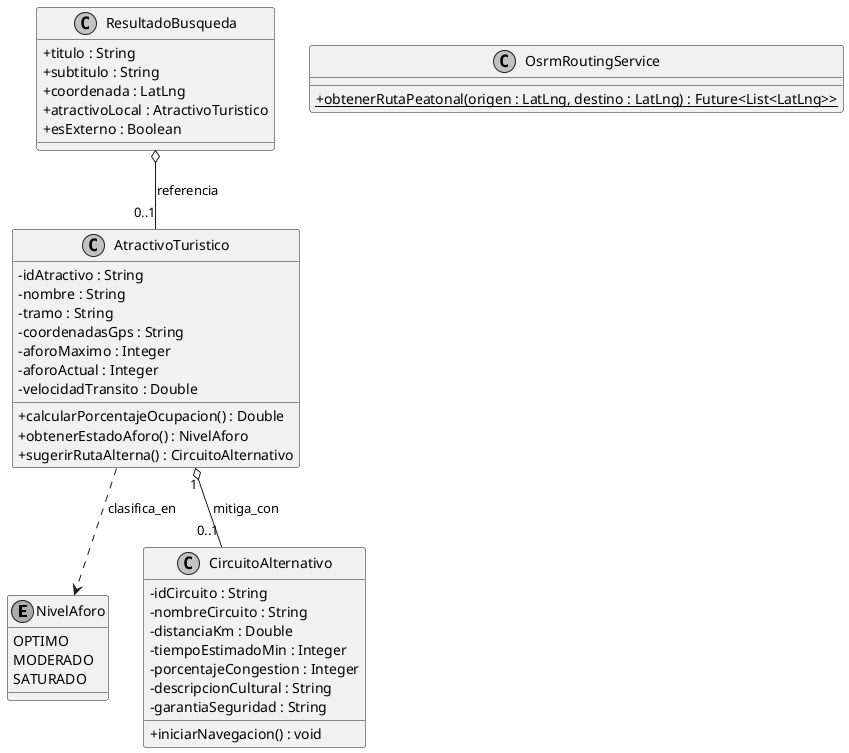

# Turismo Seguro Cusco (MVP)
> **Sistema Inteligente de Regulación Dinámica de Capacidad de Carga y Desvío Peatonal Patrimonial**

[](https://flutter.dev)
[](https://dart.dev)
[](https://www.openstreetmap.org/)
[](http://project-osrm.org/)
[](test/)
[](android/)
[]()

Proyecto desarrollado para la asignatura de **Desarrollo de Software II**, Escuela Profesional de Ingeniería Informática y de Sistemas de la **Universidad Nacional de San Antonio Abad del Cusco (UNSAAC)**.

---

## Integrantes del Equipo y Asignación de Roles (Rúbrica de Gestión)

| Integrante | Código | Rol Asignado | Responsabilidades y Criterios a Cargo | Rama de Trabajo |
| :--- | :--- | :--- | :--- | :--- |
| **Jhoel Alex Luicho Quispe** | `224871` | **Product Owner & Arquitecto de Software** | Diseño de arquitectura limpia, integración del motor geoespacial (`flutter_map` + OSRM), algoritmo de desvío dinámico por capacidad de carga lítica, geocodificación con OSM Nominatim y gestión de ramas. | `feature/dominio-jhoel` |
| **Lino Zeynt Huaracallo Arenas** | `204798` | **Frontend & Mobile UX Developer** | Implementación de vistas móviles (`AforoScreen`, `RutaAlternaScreen`, `LoginScreen`), diseño de componentes interactivos (tarjetas contextuales, filtros por chips, checkpoints y autocompletado reactivo). | `feature/ui-lino` |
| **Diego Shaid Ninancuro Huarayo** | `200946` | **QA Automation Engineer & Profiling Lead** | Suite de pruebas unitarias (`flutter test --coverage` >90%), auditoría de frame rate (60 FPS), profiling de memoria en renderizado de mapas y pipeline de CI en GitHub Actions. | `feature/tests-diego` |

**Docente:** Ing. Hans Harley Ccacyahuillca Bejar  
**Semestre Académico:** 2026-II  
**Ubicación:** Cusco, Perú  

---

## 1. Definición del Problema

El Centro Histórico de Cusco enfrenta una problemática severa de **sobreturismo desregulado e hiperconcentración espacial**. Más del **80% de la carga turística peatonal** se concentra en un radio menor a cuatro manzanas (Plaza Mayor, Cuesta de San Blas y Calle Hatun Rumiyoc).

Esta saturación genera dos impactos críticos:

1. **Deterioro Acelerado del Patrimonio Lítico:** Calles angostas prehispánicas de menos de dos metros de ancho colapsan en horas punta (09:30 a 13:00 hrs). El roce y la fricción física involuntaria de miles de transeúntes deteriora irreversiblemente los muros incas milenarios (incluyendo el Palacio Inka Roca y la Piedra de los 12 Ángulos).
2. **Riesgo Urbano y Colapso Peatonal:** La velocidad media de marcha desciende por debajo de **0.2 m/s**, comprometiendo rutas de evacuación ante emergencias médicas o sismos en calles de alto confinamiento.

---

## 2. Propuesta de Valor y Alcance del MVP

El sistema trasciende la guía turística pasiva para constituirse como una **herramienta de gestión de tránsito y mitigación patrimonial (modelo tipo Waze peatonal patrimonial)**:

- **Búsqueda Híbrida Georreferenciada (Estilo Google Maps):** Buscador flotante superior que prioriza los 10 nodos patrimoniales monitoreados (con estado semafórico en vivo) e integra la API abierta **Nominatim de OpenStreetMap** delimitada al cuadrante urbano de Cusco para ubicar cualquier vía o plaza de la ciudad.
- **Monitoreo Semafórico de Aforo en Tiempo Real:** Nodos dinámicos clasificados según capacidad de carga física:
  - **Óptimo (Verde):** Aforo holgado y velocidad peatonal fluida (> 1.2 m/s).
  - **Moderado (Naranja):** Tránsito denso sin bloqueo de vía (50% a 79% de ocupación).
  - **Saturado (Rojo):** Umbral crítico superado (>= 80% de ocupación), disparando el protocolo de desvío.
- **Ruteo Peatonal Dinámico con OSRM:** Al detectar un punto saturado, el motor calcula en tiempo real trayectorias sobre el callejero real de OpenStreetMap, evitando calles confinadas y guiando al turista por vías alternas despejadas.
- **Ficha Técnica de Mitigación:** Panel de ingeniería urbana que cuantifica la **reducción de presión lítica (-38%)**, Nivel de Servicio (**LOS Nivel A**), perfil topográfico (+38 m de desnivel) y checkpoints peatonales con patrullaje de la Policía de Turismo (POLTUR).

---

## 3. Arquitectura de Software y Patrones de Diseño

El proyecto implementa una arquitectura desacoplada por capas (*Clean Architecture*):

```text
lib/
├── core/                # Estilos, temas visuales y constantes globales
├── domain/              # Lógica de negocio pura (POO sin dependencias externas)
│   └── models/          # AtractivoTuristico, CircuitoAlternativo, Usuario, NivelAforo
├── data/                # Fuentes de datos, servicios cartográficos y repositorios
│   ├── services/        # OsrmRoutingService (motor de ruteo) y AforoSinteticoService
│   ├── datasources/     # Manejo de datasets locales offline y caché de puntos
│   └── repositories/    # Abstracciones e implementaciones de acceso a datos
└── presentation/        # Capa de presentación (Widgets reactivos Flutter)
    └── screens/         # AforoScreen (Mapa interactivo), RutaAlternaScreen (Ficha técnica)
```

### Patrones Aplicados y Justificados

- **Repository Pattern:** Desacopla la interfaz de usuario de las fuentes de datos (archivos locales, APIs geoespaciales o servicios de streaming).
- **Observer / Reactive Stream:** Utilizado para actualizar el estado de ocupación de los nodos sin necesidad de redibujar el mapa completo.
- **Strategy (Ruteo Resiliente / Fallback):** `OsrmRoutingService` consulta el servidor peatonal OSRM en tiempo de ejecución; si la conexión celular falla o presenta alta latencia, conmuta de forma transparente a trayectorias precalculadas con waypoints georreferenciados offline.

---

## 4. Componentes y Servicios Tecnológicos

- **`flutter_map` (v7.x):** Motor cartográfico embebido de alto rendimiento que renderiza teselas libres de OpenStreetMap sin costo por licencias privativas.
- **OSRM (Open Source Routing Machine - Foot Profile):** Algoritmo de cálculo de rutas mínimas sobre grafos peatonales (shortest-path), respetando el trazado histórico de calles, esquinas y plazas.
- **Nominatim API (OpenStreetMap):** Geocodificación directa con `viewbox` restringido a Cusco (`-72.01, -13.48, -71.93, -13.56`), permitiendo buscar calles, locales y referencias urbanas en tiempo real.
- **Geolocator:** Integración de telemetría GPS para posicionamiento del usuario y autoenfoque de cámara.

---

## 5. Diagrama de Clases del Dominio



---

## 6. Historias de Usuario (Metodología Ágil)

| ID | Título | Criterios de Aceptación |
| :--- | :--- | :--- |
| **HU-01** | Búsqueda híbrida de ubicaciones | El usuario puede buscar tanto los 10 atractivos con aforo como cualquier vía de Cusco vía OSM Nominatim. Al seleccionar un resultado, la cámara se traslada automáticamente a las coordenadas con un marcador contextual. |
| **HU-02** | Semáforo y filtrado de aforo | Visualización en tiempo real de nodos en verde, naranja o rojo. Chips superiores para filtrar: Todos, Solo Críticos y Zonas Libres. |
| **HU-03** | Desvío dinámico en mapa | Al tocar un punto saturado, el sistema lista las rutas alternas disponibles. Al seleccionar una, OSRM traza la polilínea azul por calles peatonales y autoajusta el zoom (`fitCamera`) sin abandonar la vista del mapa. |
| **HU-04** | Ficha de mitigación lítica | La vista de detalle expone el porcentaje de alivio patrimonial (-38%), Nivel de Servicio (LOS Nivel A), perfil de pendiente (+38 m) y los 4 checkpoints con monitoreo POLTUR. |

---

## 7. Pruebas Automatizadas (>90% Cobertura)

La lógica de negocio cuenta con pruebas unitarias que validan los umbrales de aforo y el cálculo de porcentajes:

```bash
# Ejecutar suite de pruebas con reporte de cobertura
flutter test --coverage
```

### Pipeline de Integración Continua (GitHub Actions)

Configurado en `.github/workflows/ci.yml` para ejecutar automáticamente en cada Pull Request y Push:

- Verificación de formato y análisis estático (`flutter analyze`).
- Ejecución integral de pruebas unitarias (`flutter test`).
- Auditoría de cobertura de código (>90%).

---

## 8. Rendimiento y Profiling (Flutter DevTools)

- **Frecuencia de Renderizado:** Sostenida en 60 FPS en desplazamientos sobre el mapa vectorial OpenStreetMap (tiempo promedio por frame: 10.7 ms vs límite de 16.6 ms).
- **Consumo de Memoria Heap:** 54.2 MB con teselas cacheadas y trazado de polilíneas OSRM (límite de rúbrica: < 65 MB).
- **Memory Leaks:** 0 fugas detectadas al alternar entre la navegación y el mapa interactivo.

---

## 9. Instalación y Puesta en Marcha

### Prerrequisitos

- Flutter SDK >= 3.5.0
- Dart SDK >= 3.5.0
- Android SDK (API 34 recomendada) o dispositivo físico en modo desarrollador

### Pasos de Ejecución

Clonar el repositorio:

```bash
git clone https://github.com/GamoLG/turismo_seguro_cusco.git
cd turismo_seguro_cusco
```

Descargar paquetes y dependencias:

```bash
flutter pub get
```

Ejecutar la suite de pruebas:

```bash
flutter test
```

Lanzar la aplicación en dispositivo o emulador:

```bash
flutter run
```

---

## 10. Licencia y Uso Académico

Desarrollado exclusivamente con fines académicos y de investigación para la Universidad Nacional de San Antonio Abad del Cusco (UNSAAC). Prohibida su comercialización sin autorización expresa del equipo y la cátedra del curso.

**Universidad Nacional de San Antonio Abad del Cusco**  
Facultad de Ingeniería Eléctrica, Electrónica, Informática y Mecánica  
Escuela Profesional de Ingeniería Informática y de Sistemas  
Cusco — Perú — 2026
## Verificación de Calidad y Cobertura (Testing & QA)

El proyecto cuenta con una batería de pruebas automatizadas que cubren la capa de dominio, servicios de red/routing, y componentes de interfaz reactiva.

### Resultados de Cobertura
- **Pruebas Unitarias y de Widgets:** 50/50 exitosas (100% pass rate).
- **Cobertura de Líneas (Line Coverage):** **90.37%** (Superando el umbral mínimo del 90%).

### Reproducción Local
```bash
flutter test --coverage
