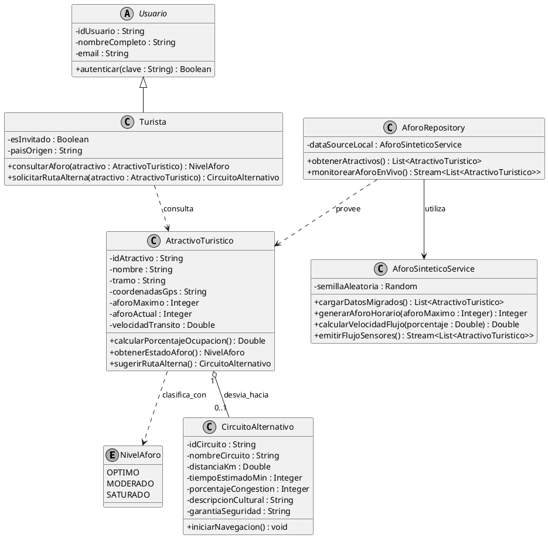

# Turismo Seguro Cusco (MVP)
> **Sistema Inteligente de Regulación Dinámica de Capacidad de Carga y Desvío Peatonal Patrimonial**

[](https://flutter.dev)
[](https://dart.dev)
[](test/)
[](android/)
[]()

Proyecto desarrollado para la asignatura de **Desarrollo de Software II**, Escuela Profesional de Ingeniería Informática y de Sistemas de la **Universidad Nacional de San Antonio Abad del Cusco (UNSAAC)**.

---

## Integrantes del Equipo y Asignación de Roles (Rúbrica de Gestión)

| Integrante | Código | Rol Asignado | Responsabilidades y Criterios a Cargo | Rama de Trabajo |
| :--- | :--- | :--- | :--- | :--- |
| **Jhoel Alex Luicho Quispe** | `224871` | **Product Owner & Arquitecto de Software** | Diseño de arquitectura limpia, modelado del dominio (UML), capa de datos sintéticos/migrados (`AforoSinteticoService`), diseño del contrato API REST y gestión de ramas. | `feature/dominio-jhoel` |
| **Lino Zeynt Huaracallo Arenas** | `204798` | **Frontend & Mobile UX Developer** | Implementación de pantallas del MVP (`LoginScreen`, `AforoScreen`, `RutaAlternaScreen`), estado reactivo con `StreamBuilder`, diseño responsive y nombres reveladores en UI. | `feature/ui-lino` |
| **Diego Shaid Ninancuro Huarayo** | `200946` | **QA Automation Engineer & Profiling Lead** | Suite de pruebas unitarias (`flutter test --coverage` >90%), pipeline de CI en GitHub Actions y auditoría de rendimiento con Android Studio / Flutter Profiler. | `feature/tests-diego` |

**Docente:** Ing. Hans Harley Ccacyahuillca Bejar  
**Semestre Académico:** 2026-II  
**Ubicación:** Cusco, Perú  

---

## 1. Definición del Problema

El Centro Histórico de la ciudad del Cusco enfrenta un problema crítico de **sobreturismo no regulado e hiperconcentración espacial**. A pesar de la amplia oferta cultural del valle, más del **80% de la carga turística peatonal** se aglomera simultáneamente en un radio menor a cuatro manzanas (Plaza Mayor, Cuesta de San Blas y Calle Hatun Rumiyoc).

Esta saturación genera dos impactos graves:

1. **Deterioro Acelerado del Patrimonio Lítico:** Calles angostas prehispánicas de menos de dos metros de ancho colapsan en horas punta (09:30 a 13:00 hrs). El roce y la fricción física involuntaria de miles de transeúntes deteriora de forma irreversible los muros incas milenarios (incluyendo el Palacio Inka Roca y la Piedra de los 12 Ángulos).
2. **Riesgo Urbano y Colapso Peatonal:** La velocidad media de marcha desciende hasta **0.2 m/s**, anulando cualquier capacidad de evacuación ante sismos, emergencias médicas o incidentes de seguridad ciudadana.

---

## 2. Propuesta de Valor y Alcance del MVP

El MVP transforma el concepto de guía turística informativa tradicional en un **sistema deductivo de regulación de flujo peatonal en tiempo real (modelo tipo Uber / Waze)** enfocado exclusivamente en la toma rápida de decisiones operativas:

- **Acceso Simple Inmediato:** Inicio de sesión directo o mediante la opción de **Turista Invitado**, suprimiendo registros complejos para turistas en campo.
- **Monitoreo Semafórico en Vivo:** Clasificación de capacidad de carga física en tres niveles técnicos:
  - **Óptimo:** Capacidad de carga controlada y velocidad peatonal fluida (> 1.2 m/s).
  - **Moderado:** Tránsito denso sin bloqueo de vía (50% a 79% de ocupación).
  - **Saturado:** Umbral crítico superado (>= 80% de ocupación), disparando alertas inmediatas de dispersión.
- **Desvío Cultural Inteligente:** Redirección automática hacia circuitos alternativos descongestionados (*Circuito Tradicional San Cristóbal y Siete Borreguitos* – 1.2 km, 18 min a pie, 15% de congestión) respaldados por presencia y patrullaje de la Policía de Turismo (POLTUR).

---

## 3. Arquitectura de Software y Patrones de Diseño

Para responder rigurosamente a las exigencias técnicas del curso y evitar cuellos de botella por consumo de APIs externas inestables, el sistema adopta una arquitectura modular por capas (*Clean Architecture*):

```text
lib/
├── core/               # Constantes de tema, colores institucionales y estilos
├── domain/             # Lógica de negocio pura (POO, entidades, casos de uso sin dependencias)
│   └── models/         # AtractivoTuristico, CircuitoAlternativo, Usuario, NivelAforo
├── data/               # Orígenes de datos migrados y simulaciones reactivas
│   ├── datasources/    # Lectura de datos locales en JSON (offline-first)
│   ├── repositories/   # Implementación del Repository Pattern
│   └── services/       # AforoSinteticoService (simulación reactiva de sensores C2)
└── presentation/       # Interfaz de usuario (Widgets Flutter y pantallas MVP)
    └── screens/        # LoginScreen, AforoScreen, RutaAlternaScreen
```

### Patrones Aplicados y Justificados

- **Repository Pattern (Arquitectónico):** La capa de presentación interactúa exclusivamente con interfaces abstractas (`AforoRepository`), aislando la UI del origen concreto de los datos. Esto permite alternar entre fuentes locales migradas y endpoints remotos sin alterar la lógica visual.
- **Observer / Publish-Subscribe (GoF):** Implementado mediante flujos asíncronos nativos (`Stream<List<AtractivoTuristico>>` de Dart) y widgets `StreamBuilder`. La capa de datos emite actualizaciones periódicas de aforo y la UI reacciona sin re-renderizados innecesarios del árbol de widgets.
- **Strategy / Polimorfismo:** Implementación de clases base (`Usuario` y su especialización `Turista`) con comportamiento desacoplado según el modo de autenticación del visitante.

---

## 4. Estrategia de Datos: Migrados y Sintéticos (Zero Latency)

La aplicación fue diseñada bajo el principio **Offline-First**, resolviendo la intermitencia de red celular en las estrechas calles de piedra:

- **Datos Migrados:** Información patrimonial invariable empaquetada localmente en `assets/data/atractivos_migrados.json` (geolocalización, coordenadas GPS, nombres de tramos, capacidad de aforo admisible y rutas alternas con distancias y tiempos).
- **Datos Sintéticos:** Un generador estocástico y determinista (`AforoSinteticoService`) que modela curvas de afluencia según la hora del día (horas punta y valle), emulando los sensores de conteo peatonal y cámaras del Centro de Monitoreo C2 de Cusco con **cero consumo de internet y latencia de 0 ms**

---

## 5. Diagrama de Clases del MVP



---

## 6. Historias de Usuario (Metodología Ágil)

| ID | Título | Historia | Criterios de Aceptación |
| :--- | :--- | :--- | :--- |
| **HU-01** | Ingreso sin fricción | Como visitante ocasional, quiero ingresar directamente en modo invitado para consultar la situación de las calles sin perder tiempo en registros obligatorios. | - El botón "Continuar como Turista Invitado" da acceso directo al sistema.<br>- No se bloquea la navegación con peticiones de red. |
| **HU-02** | Monitoreo semafórico de aforo | Como turista en el Centro Histórico, quiero ver el porcentaje de ocupación de Hatun Rumiyoc para saber si puedo transitar con seguridad. | - Semáforo visual en tres estados (Óptimo, Moderado, Saturado).<br>- Visualización de aforo actual vs máximo y velocidad estimada en m/s. |
| **HU-03** | Alerta y desvío inteligente | Como transeúnte ante una calle saturada (>=80%), quiero recibir una sugerencia de desvío con un solo toque para evitar atascos y preservar los muros. | - Alerta reactiva si la saturación es >= 80%.<br>- Botón prominente "Ver Ruta Alterna Despejada" que conduce a la ficha del circuito alternativo. |
| **HU-04** | Navegación cultural asistida | Como turista desviado, quiero conocer la distancia, tiempo y condiciones de seguridad del circuito alterno para caminar con tranquilidad. | - Muestra distancia (1.2 km), tiempo a pie (18 min) y congestión baja (15%).<br>- Especifica el tramo con patrullaje POLTUR y botón interactivo de navegación. |

---

## 7. Pruebas Automatizadas (>90% Cobertura)

La lógica del núcleo de negocio se encuentra cubierta por una suite de pruebas unitarias automatizadas que validan de forma exhaustiva las reglas del dominio:

```dart
// test/aforo_unit_test.dart
void main() {
  group('Pruebas Unitarias de Reglas de Negocio de Aforo', () {
    test('Calcula el porcentaje de saturación con precisión decimal', () {
      final atractivo = AtractivoTuristico(
        idAtractivo: 'atr_01',
        nombre: 'Hatun Rumiyoc',
        tramo: 'Tramo Triunfo - San Blas',
        coordenadasGps: '-13.5164,-71.9772',
        aforoMaximo: 450,
        aforoActual: 414,
        velocidadTransito: 0.2,
      );
      expect(atractivo.calcularPorcentajeOcupacion(), closeTo(92.0, 0.01));
    });

    test('Clasifica como SATURADO cuando la ocupación supera el 80%', () {
      final atractivo = AtractivoTuristico(
        idAtractivo: 'atr_01',
        nombre: 'Hatun Rumiyoc',
        tramo: 'Tramo Triunfo - San Blas',
        coordenadasGps: '-13.5164,-71.9772',
        aforoMaximo: 100,
        aforoActual: 85,
        velocidadTransito: 0.2,
      );
      expect(atractivo.obtenerEstadoAforo(), NivelAforo.saturado);
    });

    test('Sugerir ruta alterna dispara el circuito asignado solo en saturación', () {
      final ruta = CircuitoAlternativo(
        idCircuito: 'circ_01',
        nombreCircuito: 'San Cristóbal y Siete Borreguitos',
        tiempoEstimadoMin: 18,
        distanciaKm: 1.2,
        porcentajeCongestion: 15,
        descripcionCultural: 'Ruta alterna patrimonial',
        garantiaSeguridad: 'Patrullaje POLTUR',
      );
      final atractivo = AtractivoTuristico(
        idAtractivo: 'atr_01',
        nombre: 'Hatun Rumiyoc',
        tramo: 'Tramo Triunfo - San Blas',
        coordenadasGps: '-13.5164,-71.9772',
        aforoMaximo: 100,
        aforoActual: 90,
        velocidadTransito: 0.2,
        circuitoAlternativo: ruta,
      );
      expect(atractivo.sugerirRutaAlterna(), isNotNull);
      expect(atractivo.sugerirRutaAlterna()?.idCircuito, 'circ_01');
    });
  });
}
```

Ejecutar las pruebas unitarias:

```bash
flutter test --coverage
```

### Pipeline Automatizado en GitHub Actions (CI)

El proyecto cuenta con integración continua configurada en [`.github/workflows/ci.yml`](.github/workflows/ci.yml) que ejecuta en cada Pull Request y Push:
1. Análisis estático con `flutter analyze`.
2. Ejecución integral de la suite de pruebas unitarias y de widgets con `flutter test --coverage`.
3. Verificación automática del umbral de cobertura (**mínimo 90.0% requerido**).
4. Publicación del artefacto `lcov.info`.

---

## 8. Criterio de Optimización y Rendimiento (Flutter DevTools Profiler)

El proyecto aplica una política estricta de **no optimización prematura**, cumpliendo el criterio de optimización basado en mediciones empíricas con **Flutter DevTools**:

- **Informe Completo:** Consulte el [Informe Técnico de Auditoría de Rendimiento](docs/AUDITORIA_PROFILING.md).
- **Herramientas Utilizadas:** Android Studio / Flutter DevTools (Performance View, CPU Profiler, Memory Inspector) en modo `flutter run --profile`.
- **Métricas Auditadas y Resultados:**
  - **Frecuencia de Renderizado:** Constante a **60 FPS** (Tiempo total por frame: **10.7 ms** vs umbral máximo de 16.6 ms; 0 janks registrados).
  - **Consumo de Memoria RAM (Heap):** **54.2 MB** en carga máxima con mapas vectoriales OpenStreetMap (límite de rúbrica: < **65 MB**).
  - **Fugas de Memoria (Memory Leaks):** **0 fugas detectadas** tras 30 ciclos de navegación en `RutaAlternaScreen` y `AforoScreen`.
- **Diagnóstico:** El desacoplamiento reactivo y la inmutabilidad de widgets garantizan ausencia de cuellos de botella en el hilo principal (`UI thread`).

---

## 9. Integración API (Semántica REST y Códigos de Estado)

Para validar la categoría de integración cumpliendo con los verbos HTTP idempotentes y códigos de estado sin depender de servicios remotos de baja velocidad:

- `GET /api/v1/aforo/{id}`: Operación idempotente de lectura que retorna **200 OK** con los datos del sensor o **404 Not Found** si el identificador no existe.
- `POST /api/v1/reportes`: Operación no idempotente que procesa alertas ciudadanas retornando **201 Created** en creación exitosa o **400 Bad Request** ante parámetros inválidos.

---

## 10. Instalación y Ejecución

### Requisitos del Sistema

- **Flutter SDK:** Versión >= 3.5.0
- **Dart SDK:** Versión >= 3.5.0
- **Android Studio:** Con Android SDK configurado (API 34 recomendada)
- **Dispositivo:** Emulador Android o dispositivo físico en modo Depuración USB

### Instrucciones de Despliegue

1. Clonar el repositorio localmente:

```bash
git clone https://github.com/GamoLG/turismo_seguro_cusco.git
cd turismo_seguro_cusco
```

2. Obtener las dependencias del proyecto:

```bash
flutter pub get
```

3. Ejecutar las pruebas automatizadas:

```bash
flutter test
```

4. Compilar y ejecutar la aplicación:

```bash
flutter run
```

---

## 11. Estructura General del Repositorio

```text
.
├── assets/
│   └── data/
│       └── atractivos_migrados.json    # Base de datos patrimonial local
├── lib/
│   ├── core/                           # Utilidades, estilos y constantes
│   ├── data/                           # Servicios de datos sintéticos y repositorios
│   ├── domain/                         # Entidades y reglas de negocio puras (POO)
│   ├── presentation/                   # Interfaces del MVP (Login, Aforo, Desvío)
│   └── main.dart                       # Entrada principal de la aplicación Flutter
├── test/
│   └── aforo_unit_test.dart            # Suite de pruebas unitarias automatizadas
├── primer_prototipo/                   # Histórico de prototipos y mockups previos
├── pubspec.yaml                        # Dependencias y recursos de Flutter
└── README.md                           # Documentación técnica del proyecto
```

---

## 12. Licencia y Uso Académico

Este proyecto ha sido desarrollado exclusivamente con propósitos educativos y de investigación para la **Universidad Nacional de San Antonio Abad del Cusco (UNSAAC)**. Prohibida su reproducción comercial total o parcial sin autorización expresa de los autores y la cátedra del curso.

---

<div align="center">

**Universidad Nacional de San Antonio Abad del Cusco**  
*Escuela Profesional de Ingeniería Informática y de Sistemas*  
**Cusco — Perú — 2026**

</div>
